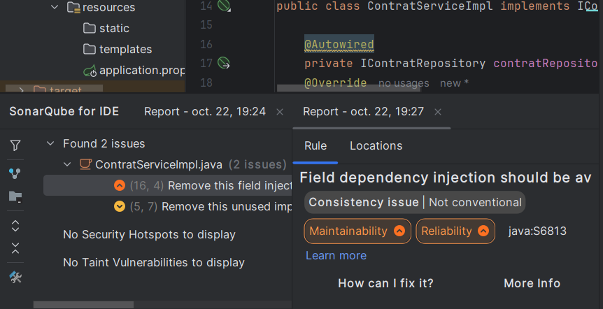

A . Mode d'injectioncomparé
 : Régle S6813 dependency injection should be avoided
==> use constarctor injection instead of field injection
B . Services

| Service                 | Dépendances injectées  | Mode         | Justification                                          |
|-------------------------|------------------------|--------------|--------------------------------------------------------|
| AgenceServiceImpl       | IAgenceRepository      | Constructeur | Champ final, service sans état, dépend d'une interface |
| EmployeServiceImpl      | IEmployeRepository     | Constructeur | Idem                                                   |
| VehiculeServiceImpl     | IVehiculeRepository    | Constructeur | Idem                                                   |
| EquipementServiceImpl   | IEquipementRepository  | Constructeur | Idem                                                   |
| ClientServiceImpl       | IClientRepository      | Constructeur | Idem                                                   |
| ReservationServiceImpl  | IReservationRepository | Constructeur | Idem                                                   |
| ContratServiceImpl      | IContratRepository     | Constructeur | Idem                                                   |
| PaiementServiceImpl     | IPaiementRepository    | Constructeur | Idem, lecture seule (le Contrat porte ses paiements)   |
| MaintenanceServiceImpl  | IMaintenanceRepository | Constructeur | Idem                                                   |
C . Messages d'erreur
    Message 1 :
        NoSuchBeanDefinitionException
        Aucun bean de type 'IContratService'
        cause : classe hors package
        solution : ajouter @Service ou déplacer la classe
    
    Message 2 :
        NoUniqueBeanDefinitionException
        2 bean de mm type (emailnotificateur , smsnotificateur)
        solution : @primary sur la classe bean ou @qualifier ("emailNotificateur") sur apram du constructeur du controlleur
    
    Message 3 :
        dépendance circulaire
        les 2 services s'injectent mutuellement
        ==> logique commune dans un 3eme service qui depends des deux
        
D . Anomalies SonarQube for IDE
    exception génétique : S112 : Generic exceptions should never be thrown
    injection par attribut : deja mentionné dans A
    commentzire : S125 : Sections of code should not be commented out
    
E . Questions de compréhension
    1. Où est le new de ContratServiceImpl et qui l’exécute ? 
    ==> le new est dans le conteneur Spring, c’est lui qui instancie les beans et les injecte dans les controlleurs.
    Il détecte la classe grâce à @Service et au scan des composants à partir du package racine et appelle ensuite le constructeur géénré par @requiredArgsConstructor

    2. Pourquoi un contrôleur dépendra-t-il de IContratService et non de ContratServiceImpl ?
    ==> pour respecter le principe de l’inversion de dépendance (D de SOLID) et pour permettre de changer l’implémentation sans modifier le contrôleur.

    3. Pourquoi un service singleton doit-il rester sans état ? Exemple de bug.
    ==> parce que le service est partagé entre tous les threads et toutes les requêtes, donc si on stocke un état dans le service, il sera partagé entre tous les utilisateurs et toutes les requêtes, ce qui peut provoquer des bugs.
    Exemple : un attribut private Contrat contratCourant; dans le service. La requête de l’utilisateur A le remplit, la requête de l’utilisateur B le remplace avant que A ait fini, et A modifie ou affiche alors le contrat de B.

    4. Pourquoi update charge-t-il l’entité existante avant d’appeler save ?
    ==> pour éviter de créer une nouvelle entité au lieu de mettre à jour l’existante. Si on appelle save avec une entité qui a un id null, JPA va créer une nouvelle entité au lieu de mettre à jour l’existante.
    déclenche un merge qui écraserait toutes les colonnes avec les valeurs reçues, y compris celles absentes du JSON (qui deviendraient null)

    5. Quelle différence entre @Component et @Bean ? Entre @Primary et @Qualifier ? Pourquoi IPaiementService n'expose-t-il ni création, ni modification, ni suppression ?
    @Component / @Bean : @Component se pose sur une classe que l’on écrit, et le scan la détecte automatiquement. @Bean se pose sur une méthode d’une classe @Configuration : il sert à déclarer explicitement un bean pour une classe qu’on ne peut pas annoter (bibliothèque, classe du JDK) ou dont la construction est particulière.
    @Primary / @Qualifier : @Primary se pose sur la classe et désigne le candidat par défaut. @Qualifier se pose à l’injection (sur le paramètre) et choisit explicitement le bean voulu.
    IPaiementService en lecture seule : Paiement est en composition avec Contrat (cascade = ALL, orphanRemoval = true). Un paiement n’a pas de vie propre : le code métier le crée et le supprime en passant par le Contrat. Exposer la création, la modification ou la suppression directement le rendrait possible sans passer par son parent, avec le risque de paiements incohérents ou orphelins.
